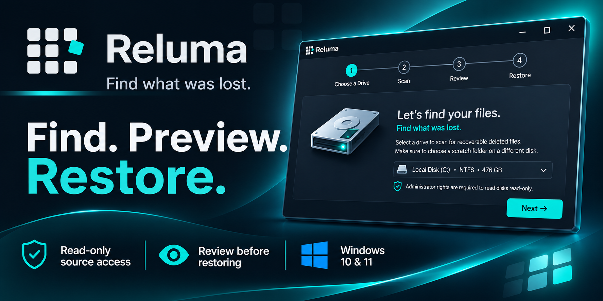

# Reluma

**Find what was lost.**

**Find. Preview. Restore.**

Reluma is a Windows deleted-file recovery application designed to help you locate recoverable files, review their condition, and restore the files you choose.

With read-only source access, recovery condition ratings, and verification after restoration, Reluma provides a controlled recovery workflow that keeps you in charge.

[DOWNLOAD](https://github.com/fastsolutionsllc/Reluma/raw/refs/heads/main/Installer/Reluma-Setup-1.0.0.exe)

---

## Overview

Reluma helps you:

- Scan supported Windows storage volumes for recoverable deleted files.
- Recover deleted-file records from NTFS metadata.
- Search for files using file-signature scanning.
- Review recovery results before restoring.
- Preview supported file types.
- Search, filter, and sort recovery results.
- Restore selected files to a separate physical disk.
- Verify restored files using file size and SHA-256 hash comparison.

Reluma is designed around one principle:

> Know what can be found. Choose what to restore. Stay in control.

## How It Works

Reluma uses a simple four-step workflow.

### 1. Choose a Drive

Select a supported mounted volume and choose a scratch folder on a different physical disk.

Reluma identifies supported volumes and provides warnings about conditions that may affect recovery.

### 2. Scan

Reluma scans the selected volume using read-only source access.

The scan combines NTFS metadata recovery with file-signature scanning where supported.

### 3. Review

Review the files Reluma finds.

Search by filename or location, filter by file type, inspect supported previews, and review the recovery condition of each result.

Recovery conditions are presented as:

- **Good**
- **Partial**
- **Poor**

These ratings help you assess available recovery information before restoring.

### 4. Restore

Select the files you want to recover and choose a destination on a different physical disk.

Reluma re-reads the restored files and verifies their size and SHA-256 hash.

---

## Designed for a Controlled Recovery Process

### Read-only source access

Reluma opens source volumes for reading only.

Its recovery process does not intentionally write recovered data, temporary files, or an index to the source volume.

### Separate physical destination

Restoring recovered data to the source disk can overwrite data that may still be recoverable.

Reluma blocks restoration to the same physical disk as the source. A different drive letter does not necessarily mean a different physical disk.

### Review before restoring

Not every deleted file is recoverable in its original condition.

Reluma provides recovery condition ratings so you can review the available information before choosing what to restore.

### Verification after restoration

After restoration, Reluma re-reads each destination file and compares its size and SHA-256 hash against the bytes read from the source.

This verifies the restoration process. It does **not** establish that recovered bytes are identical to the original file before deletion.

---

## Compatibility

Reluma v1 supports:

| Platform / filesystem | Support |
|---|---|
| Windows 10, version 22H2 | Supported |
| Windows 11 | Supported |
| 64-bit Windows systems | Supported |
| Basic disks | Supported |
| NTFS | Deleted-record parsing and file-signature scanning |
| FAT | File-signature scanning |
| exFAT | File-signature scanning |
| BitLocker-encrypted volumes | Not supported in v1 |

Reluma works with supported mounted volumes that have drive letters.

### SSD recovery

Reluma can scan supported SSD volumes, but SSD TRIM may significantly reduce recovery prospects.

Recovery results depend on the storage device, filesystem, deletion history, and whether data has been overwritten or made inaccessible.

**Reluma does not guarantee recovery.**

---

## Technology

Reluma is built using:

- **Python** — application and recovery orchestration
- **PySide6 / Qt 6** — desktop user interface
- **Win32 API via `ctypes`** — native Windows storage access
- **NTFS metadata parsing** — deleted-file record recovery
- **File-signature scanning** — recovery where filesystem metadata is unavailable
- **SHA-256** — post-restoration verification
- **PyInstaller** — Windows application packaging

The application uses a worker-thread architecture for scanning so that disk operations do not block the user interface.

---

## System Requirements

- Windows 10 version 22H2 or Windows 11
- 64-bit Windows system
- Administrator privileges for supported storage access
- A supported mounted volume
- A scratch folder on a different physical disk
- A separate physical disk for recovered files

Avoid writing new data to the drive from which you are attempting to recover files. New writes may overwrite recoverable data.

---

## Getting Started

Reluma is distributed as a Windows desktop application.

1. Download Reluma from the official product page.
2. Launch the application.
3. Activate your license using the license key included with your purchase.
4. Select a supported volume.
5. Choose a scratch folder on a different physical disk.
6. Scan and review the results.
7. Restore selected files to a separate physical disk.

**Official product page:** [Reluma](https://gumroad.com/)

Replace the product link above with the direct Reluma product URL before publishing this README.

---

## License and Distribution

Reluma is a commercial software product distributed under its applicable license terms.

The application license, activation scope, and update policy are defined by the terms provided with the purchase.

This repository does not grant permission to redistribute Reluma binaries, license keys, or commercial assets unless explicitly authorized.

---

## Support

For product, installation, or activation assistance, use the support channel provided with your purchase.

When requesting activation assistance, include the relevant purchase information and activation error. Do not send passwords or unrelated personal information.

---

## Important Recovery Disclaimer

File recovery is not guaranteed.

Recovery prospects depend on multiple factors, including:

- Filesystem and storage-device condition
- Deletion history
- Whether data has been overwritten
- SSD TRIM behavior
- Whether the volume is supported and accessible

Reluma is designed to help you make informed recovery decisions. It cannot guarantee that deleted files will be found or restored in their original condition.

---

**Reluma — Find what was lost.**
